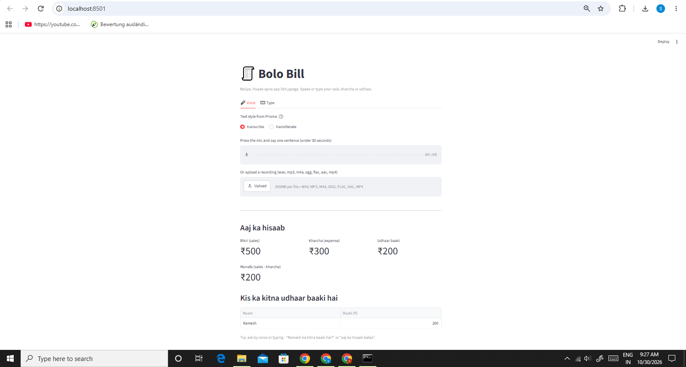

# 🧾 Bolo Bill - Voice Ledger for Shopkeepers

**Boliye, hisaab apne aap likh jayega.**

Bolo Bill lets a small shopkeeper keep a daily ledger just by talking. Say a sentence in Hindi or Hinglish, like *"aaj paanch sau ka maal becha"* or *"Ramesh ko do sau ka udhaar diya"*, and the app writes the entry, shows today's totals, and reads the total back out loud.

Built for the **Great Indian AI Internship Challenge by Gnani AI**.

   

## The problem

Many shopkeepers keep their hisaab in a notebook, or in their head. Typing in an app is slow when your hands are busy, and most apps are in English. Udhaar (credit) is easy to forget. Bolo Bill makes the ledger a voice habit.

## Who will use it

Kirana and small-shop owners who speak Hindi/Hinglish and want a simple way to track sales, expenses and credit.

## What it does

- **Voice entry:** record or upload a sentence; it is turned into a ledger entry (sale, kharcha, udhaar diya, udhaar wapas).
- **Customer names:** "Ramesh ko do sau ka udhaar diya" tracks who owes how much.
- **Voice questions:** ask "Ramesh ka kitna baaki hai?" or "aaj ka hisaab batao" and hear the answer.
- **Weekly report:** 7-day table and chart, a spoken summary, and a download for Excel.
- **Typing works too**, so the ledger logic can be used without the API.

## Gnani AI technology used

| Model | Used for |
|-------|----------|
| **Gnani Prisma v3.0** (speech-to-text) | Turns the shopkeeper's voice into text |
| **Gnani Timbre v3.0** (text-to-speech) | Reads totals, balances and reports out loud |

## How it works

```
voice  ->  Prisma (STT)  ->  sentence parser  ->  ledger.csv  ->  totals / answers  ->  Timbre (TTS)  ->  voice
```

- `bolo_stt.py` - calls Prisma, with error handling and one retry
- `bolo_tts.py` - calls Timbre, with error handling and one retry
- `ledger.py` - finds the type, amount (digits and Hindi number words) and customer name; totals, balances, questions, weekly report
- `app.py` - the Streamlit page

The parser uses simple rules (keyword lists and a Hindi number-word reader), not a trained model. The AI parts are Gnani's speech models.

## Run it

```bash
pip install -r requirements.txt
```

Set your Gnani API key (never put it in a file you upload):

```bash
# Windows (Command Prompt)
set GNANI_API_KEY=your-key-here

# Mac / Linux
export GNANI_API_KEY=your-key-here
```

Start the app:

```bash
python -m streamlit run app.py
```

The **Type** tab works without a key. The **Voice** tab and the read-out buttons need `GNANI_API_KEY`.

## Limits (honest notes)

- Tuned for Hindi and Hinglish. Other Indian languages are supported by the Gnani models, but the sentence parser is not yet tuned for them.
- If Prisma writes a name in Devanagari one time and in English letters another time, they count as two customers. Use one text style consistently.
- Odd number words (like "paintalis") are not understood in word form; the `transcribe` style gives digits and works best.
- Gnani allows one request at a time, so wait for the voice to finish before pressing another button.

## Author

Shubh Mehta
